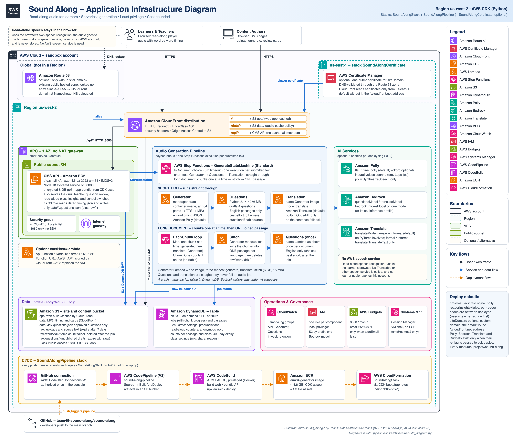

# AWS services used by Sound Along

This document lists every AWS service the app uses and what each one is for. It is based on the CDK code in
`infra/` (`app.py` and `infra/sound_along/*.py`). Everything runs in `us-west-2` (except the optional global Route 53 records and the optional us-east-1 ACM certificate), and every resource is tagged
`project=sound-along`.

The diagram source is `architecture/sound-along-architecture.svg`. To regenerate both files after an infrastructure
change, run `python docs/architecture/build_diagram.py`. The script embeds the official
[AWS Architecture Icons](https://aws.amazon.com/architecture/icons/) stored in `architecture/icons/`, and it uses
headless Edge or Chrome to render the PNG.

## Stacks

| Stack | What it contains |
|---|---|
| `SoundAlongStack` | The application: delivery, CMS API, generation pipeline, data, AI integrations, logs, budget. |
| `SoundAlongPipeline` | The CI/CD pipeline that deploys `SoundAlongStack` on every push to `main` (see [PIPELINE.md](PIPELINE.md)). |
| `CDKToolkit` (bootstrap) | Not part of this repo. It provides the asset bucket, the ECR repository and the `cdk-hnb659fds-*` deploy roles. |

## Deploy flags that change which services exist

| Flag (`-c`) | Default | Effect |
|---|---|---|
| `cmsHost` | `ec2` | `ec2` runs the CMS API on an EC2 instance in its own VPC. `lambda` runs it as a Lambda function with a Function URL instead. |
| `ttsEngine` | `polly` | Narration engine. `polly` (the default) uses Amazon Polly; `kokoro` runs inside the generator image and calls no AWS service. A teacher can still choose per job in Settings. |
| `translateModel` | `amazon:informal` | `amazon[:formal\|informal]` uses Amazon Translate (the default), `bedrock:<modelId>` uses Amazon Bedrock, and `builtin` uses only the built-in Opus-MT translator. The built-in model stays in the image as the per-sentence fallback and is loaded only when needed. |
| `questionsModel` + `questionsEnabled=true` | none / off | Turns on question drafting with Amazon Bedrock. |
| `alertEmail` | none | Creates the AWS Budgets cost budget. |
| `siteDomain` | none (optional) | A custom public hostname (for example `sound-along.online`). Adds an Amazon Route 53 hosted-zone lookup, alias records, and a us-east-1 ACM certificate (stack `SoundAlongCertificate`) on the CloudFront distribution. With no value, the site is served only on its `*.cloudfront.net` domain. |
| `readerInsights` | `false` | `true` lets a device add an anonymous per-reader code to the read-aloud class insights. The default is off when deployed, and the teacher must sign in first. It changes no AWS resource, only an environment variable on the API. |

## Services

### Content delivery and networking

| Service | Resources | Use case |
|---|---|---|
| **Amazon CloudFront** | One distribution, Origin Access Control, custom audio cache policy | The single public entry point (HTTPS). `/*` serves the web app from S3 `app/`. `/data/*` serves the MP3, timing and card files from S3 `data/`, and CloudFront handles Range requests for audio seeking. `/api/*` forwards to the CMS API with caching off. It uses PriceClass 100 and the managed security-headers policy. |
| **Amazon Route 53** | Existing public hosted zone (looked up by name) with apex alias `A`/`AAAA` records to the CloudFront distribution | A global service (drawn outside the Region box in the diagram). Created only when `siteDomain` is set. Maps the custom domain to CloudFront. The domain is registered at an external registrar (Namecheap) and its nameservers are delegated to the Route 53 hosted zone; the hosted zone itself is created once outside the stack, and the stack looks it up and manages the alias records. |
| **AWS Certificate Manager (ACM)** | One DNS-validated public certificate for `siteDomain`, in `us-east-1` | Created only when `siteDomain` is set. CloudFront reads certificates only from `us-east-1`, so the certificate lives in a small `us-east-1` stack (`SoundAlongCertificate`) and the application stack references it across regions. DNS validation records are written automatically into the Route 53 hosted zone, and the certificate is attached to the distribution as its viewer certificate alongside the alternate domain name. |
| **Amazon VPC** | VPC with 1 AZ and one public `/24` subnet, internet gateway, security group. No NAT gateway. | Created only when `cmsHost=ec2`. It hosts the CMS instance. The security group admits only CloudFront's origin-facing prefix list on port 8080 and has no SSH rule. Skipping the NAT gateway keeps the idle cost low. |

### Compute

| Service | Resources | Use case |
|---|---|---|
| **Amazon EC2** | One `t4g.small` instance: Amazon Linux 2023 arm64, IMDSv2, encrypted 8 GB gp3 volume | Default CMS API host (`cmsHost=ec2`). A Node 18 systemd service on `:8080` handles uploads, job submission, card review, the quiz, teacher question review (drafts and publishing), read-aloud class insights and the school switches. Its first-boot script installs Node from a checksum-verified tarball and the app bundle from a CDK S3 asset. |
| **AWS Lambda** | `GeneratorFunction` (container image, arm64, 6 GB, 15 min) | Turns a passage into audio. It has three modes. `generate` parses the text, synthesizes speech (Kokoro by default, Polly when `ttsEngine=polly`), and writes the MP3 and word-timing JSON to S3 `data/`. `translate` translates the passage (Opus-MT, or Bedrock or Amazon Translate when configured). `stitch` joins the chunks of a long document into one passage per language and deletes the temporary work folder `raw/work/<id>/`. |
| | `QuestionsFunction` (Python 3.14, 256 MB, 2 min) | Drafts 4 practice questions for English passages with Bedrock, once per document. It writes only to `raw/questions/*`, so a draft is never served before a teacher approves it. It is off unless `questionsEnabled=true`. |
| | `ApiFunction` (Node 18, arm64, 512 MB, Function URL with `AWS_IAM` auth) | The CMS API when `cmsHost=lambda`. CloudFront signs the requests through OAC. |
| | CDK custom-resource function | Looks up the CloudFront prefix list ID at deploy time for the EC2 security group. |
| **AWS Step Functions** | `GenerateStateMachine` (Standard, 8 h timeout) | Runs one execution per submitted text; an `IsDocument` choice picks the path. A short text runs straight through: Generator, then Questions (English only), then Translation. A long document is narrated in internal chunks, one at a time (`EachChunk` Map, max concurrency 1): each chunk is generated and translated, and the progress is counted on the job in DynamoDB. A stitch step then joins the chunks into one passage, and Questions run once for the whole document (English only). Questions and translation are caught so they can never fail an audio job. A crash is marked `failed` directly in DynamoDB so the page shows it. |

### AI services (optional)

| Service | Enabled by | Use case and permission |
|---|---|---|
| **Amazon Polly** | `ttsEngine=polly` | Neural narration with the Joanna (English) and Lupe (Spanish) voices by default. The only permission is `polly:SynthesizeSpeech`. |
| **Amazon Bedrock** | `questionsModel` and/or `translateModel=bedrock:<id>` | LLM question drafting and context-aware translation. `bedrock:InvokeModel` is granted on one model only, or on its `us.` inference profile. Callers pace themselves to stay under about 1 request per second for the account. |
| **Amazon Translate** | `translateModel=amazon:informal` (default) | Machine translation of passages. The only permission is `translate:TranslateText`. |

### Data

| Service | Resources | Use case |
|---|---|---|
| **Amazon S3** | App bucket (Block Public Access, SSE-S3, SSL enforced) | `app/` holds the web build. `data/` holds the published MP3, timing, cards and pictures, served through CloudFront, plus `data/<id>.questions.json` (only teacher-approved questions; the API role may write only that pattern and read only `data/*.timing.json`). `raw/` holds uploaded source text and expires after 7 days. Inside it, `raw/work/<id>/` is the temporary chunk work folder of a long document (deleted after the join) and `raw/questions/` holds unpublished question drafts. |
| | Pipeline artifact bucket | CodePipeline source and build artifacts. |
| **Amazon DynamoDB** | One table (`pk`/`sk`, on-demand, TTL on `ttl`) | Jobs (with chunk progress), passages and CMS state, plus the read-aloud data: anonymous word counters per passage and class (they expire after 400 days) and the class settings (microphone, sharing, reader codes). The API and the generator read and write it, and Step Functions updates it when a job fails and as each chunk finishes. |

### Speech recognition for read-aloud

No AWS speech service is used. Read-aloud uses the browser's own speech recognition: the audio goes to the browser maker's speech service, never to this AWS account, and it is never stored here. Only anonymous word counts reach the API.

### Operations, security and cost

| Service | Resources | Use case |
|---|---|---|
| **AWS IAM** | One role per component | Least-privilege access. Each role gets only the S3 prefixes, the table, `states:StartExecution` and the AI calls it needs. The CodeBuild role may only assume the CDK bootstrap roles. |
| **Amazon CloudWatch Logs** | Log groups for the API, Generator and Questions functions, kept for 1 week | Troubleshooting function runs. CodeBuild logs stream here too. |
| **AWS Systems Manager** | Session Manager (`AmazonSSMManagedInstanceCore` on the instance role) | Shell access to the CMS instance without SSH or an open port. The `CmsSessionCommand` stack output prints the command. |
| **AWS Budgets** | Monthly cost budget of $500 | Emails `alertEmail` when actual spend passes 25%, 50% and 80%. It is created only when `alertEmail` is set. |

### CI/CD and deployment

| Service | Resources | Use case |
|---|---|---|
| **AWS CodeStar Connections** | GitHub v2 connection | Links CodePipeline to `team49-sound-along/sound-along`. It must be authorized once in the console. |
| **AWS CodePipeline** | `sound-along-pipeline` (V2) | Runs Source and then BuildAndDeploy on every push to `main`. |
| **AWS CodeBuild** | `sound-along-build-deploy` (ARM, LARGE, privileged) | Builds the web app, bundles the API, then runs `cdk deploy SoundAlongStack`. The privileged mode lets it build the arm64 generator Docker image natively. |
| **Amazon ECR** | CDK bootstrap image repository | Stores the generator container image (about 4.6 GB), which Lambda pulls. |
| **AWS CloudFormation** | `SoundAlongStack`, `SoundAlongPipeline`, `CDKToolkit` | CDK synthesizes the templates and CloudFormation deploys them. |

## Stack outputs

`SiteUrl`, `BucketName`, `TableName`, `StateMachineArn`, `CmsHost`, `TtsEngine`. With `cmsHost=ec2` the stack also
outputs `CmsInstanceId` and `CmsSessionCommand`.
